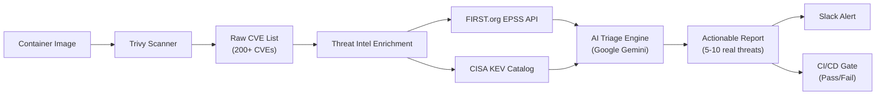
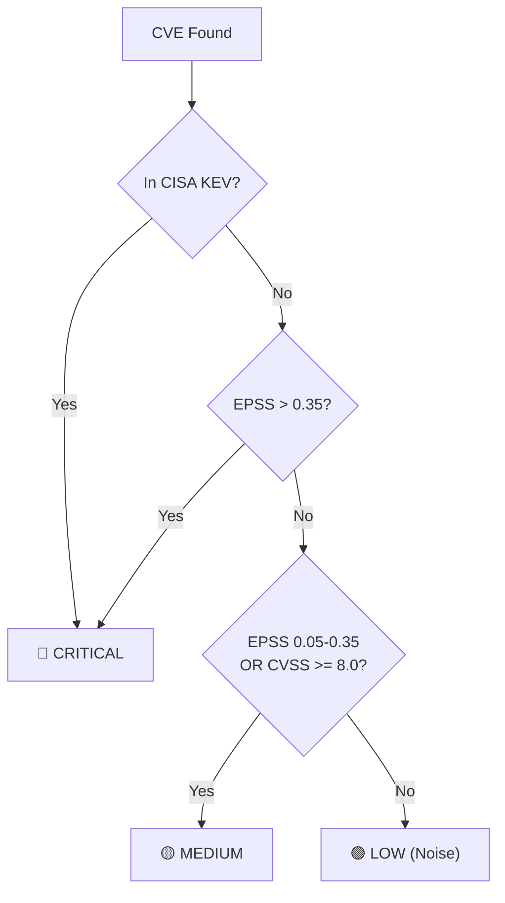

# 🛡️ Autonomous DevSecOps Container Vulnerability Triage Agent

> An intelligent, zero-cost pipeline that transforms noisy container vulnerability scans into actionable security intelligence using real-time threat data and AI-powered reasoning.

[](https://github.com/Prnasin/EXPO/actions)
[](https://share.streamlit.io)


---

### 🌐 Quick Links
- **Interactive Web Dashboard**: [Live Streamlit App](https://share.streamlit.io) *(Claiming the Functional Deployed Prototype Bonus)*
- **GitHub Actions Pipeline**: [Latest Automated Runs & Step Summaries](https://github.com/Prnasin/EXPO/actions)
- **Demo Vulnerable Dockerfile**: [docker/Dockerfile.demo](docker/Dockerfile.demo)

---

## 🎯 The Problem

**Alert fatigue** is a massive challenge in modern DevSecOps. Standard scanners like Trivy often dump hundreds of CVEs into the lap of security teams. For instance, a typical scan of a Python base image might return 200+ CVEs, but fewer than 5% of these have actual real-world exploits. Security teams are thus forced to waste countless hours triaging false positives.

Furthermore, relying on CVSS scores alone is highly misleading. A CVE with a theoretical CVSS of 9.8 but an EPSS of 0.001 has almost zero chance of actually being exploited in the wild, yet traditional tools would flag it as a critical priority.

## 🏗️ Architecture

Below is the high-level architecture of the vulnerability triage pipeline:



The priority classification logic operates as follows:



## 🔑 Key Innovation: EPSS vs CVSS

The core philosophy of this agent hinges on shifting from theoretical risk to practical risk.

| Metric | What it Measures | Source | Problem |
|--------|-----------------|--------|----------|
| **CVSS** | Theoretical severity (0-10) | NVD | Static, doesn't reflect real-world exploitation |
| **EPSS** | Probability of exploitation in next 30 days (0-1) | FIRST.org | Dynamic, evidence-based, updated daily |

**Real-world example:** CVE-2021-44228 (Log4Shell) has a CVSS of 10.0 AND an EPSS of 0.97 — making it a truly critical vulnerability. However, a hypothetical CVE-XXXX-YYYY might have a CVSS of 9.8 but an EPSS of 0.002. This means it is theoretically severe but practically unexploited, and therefore should not block a deployment.

## 🚀 Quick Start

### Prerequisites
- Python 3.10+
- Docker (for building test images)
- Trivy CLI installed
- Google Gemini API key (free at https://aistudio.google.com/apikey)

### Local Setup
```bash
# Clone the repository
git clone https://github.com/yourusername/devsecops-triage-agent.git
cd devsecops-triage-agent

# Install dependencies
pip install -r requirements.txt

# Configure environment
cp .env.example .env
# Edit .env with your API keys

# Build the demo vulnerable image
docker build -t demo-vulnerable-app:test -f docker/Dockerfile.demo .

# Run Trivy scan
trivy image --format json --output trivy-results.json --severity HIGH,CRITICAL demo-vulnerable-app:test

# Run the triage agent
python -m src.main --trivy-json trivy-results.json
```

### GitHub Actions Setup
1. Fork this repository
2. Go to Settings → Secrets → Actions
3. Add `GEMINI_API_KEY` (required)
4. Add `SLACK_WEBHOOK_URL` (optional)
5. Push code or open a PR — the pipeline runs automatically

## 📊 Sample Output

```text
╔══════════════════════════════════════════════════════════════╗
║   🛡️  Autonomous DevSecOps Container Vulnerability Triage   ║
╚══════════════════════════════════════════════════════════════╝

[Step 1/5] 📋 Parsing Trivy scan results...
  → Found 247 total vulnerabilities
  → Severity breakdown: CRITICAL=12, HIGH=45, MEDIUM=120, LOW=70

[Step 2/5] 🔍 Enriching with threat intelligence...
  → EPSS scores fetched for 247 CVEs
  → CISA KEV catalog loaded (1,147 known exploited CVEs)
  → Priority breakdown: CRITICAL=3, MEDIUM=8, LOW=236

[Step 3/5] 🤖 Running AI-powered triage...
  → Analyzing 11 high-priority CVEs (skipping 236 noise CVEs)
  → AI triage complete

[Step 4/5] 📨 Sending Slack notification...
  → Slack alert sent successfully

[Step 5/5] 🚦 Evaluating CI/CD gate...
  → Gate Decision: FAIL (3 actively exploited CVEs found)
  → Exit code: 1
```

## 🔧 Configuration

| Variable | Required | Default | Description |
|----------|----------|---------|-------------|
| `GEMINI_API_KEY` | Yes* | - | Google Gemini API key (*pipeline falls back to heuristic mode if absent) |
| `SLACK_WEBHOOK_URL` | No | - | Slack incoming webhook URL |
| `TRIVY_RESULTS_PATH` | No | `trivy-results.json` | Path to Trivy JSON output |
| `GEMINI_MODEL` | No | `gemini-2.0-flash` | Gemini model to use |
| `LOG_LEVEL` | No | `INFO` | Logging level |

## 🧪 How It Works: Deep Dive

### Step 1: Container Scanning
Trivy scans the container image layers and identifies all packages with known CVEs. Output is generated as structured JSON.

### Step 2: Threat Intelligence Enrichment
Each CVE is enriched with:
- **EPSS Score**: Real-time exploit probability from FIRST.org (updated daily).
- **CISA KEV Status**: Boolean indicator of whether the vulnerability is actively exploited in the wild.
- **Priority Classification**: Categorized into CRITICAL / MEDIUM / LOW based on enriched threat data.

### Step 3: AI-Powered Triage
Only CRITICAL and MEDIUM CVEs are sent to Google Gemini for analysis. The LLM:
- Validates the priority classification.
- Generates an executive summary suitable for stakeholders.
- Produces context-aware, specific remediation commands.
- Makes a CI/CD gate decision based on the holistic risk profile.

### Step 4: Notification & Gating
- Sends a robust Slack alert detailing the analysis and noise reduction stats.
- CI/CD gate evaluates the final output: FAIL blocks the deployment, PASS allows it to proceed smoothly.

## 🎓 Interview Talking Points (Enterprise / BFSI)

This section is designed to help you explain this project confidently in interviews.

### Q1: "Why not just use CVSS scores to prioritize vulnerabilities?"
**Answer**: CVSS measures theoretical severity, not real-world exploitability. A CVE with CVSS 9.8 sounds terrifying, but if its EPSS score is 0.001 (0.1% chance of exploitation in 30 days), it's practically noise. Conversely, a CVE with CVSS 7.5 and EPSS 0.85 is being actively weaponized. Our agent uses EPSS — a data-driven, daily-updated metric from FIRST.org — to prioritize what attackers are ACTUALLY exploiting, not what they COULD theoretically exploit.

### Q2: "How does this reduce alert fatigue?"
**Answer**: A typical container scan returns 200-300 CVEs. Our pipeline typically reduces actionable alerts to 5-15 (a 95%+ noise reduction). We achieve this by cross-referencing three data sources: CVSS (theoretical severity), EPSS (real-world exploit probability), and CISA KEV (confirmed active exploitation). Only CVEs with evidence of real-world exploitation reach the security team.

### Q3: "Why use an LLM instead of just rules?"
**Answer**: The heuristic rules (EPSS thresholds, KEV lookup) handle 90% of cases. The LLM adds value by: (1) Generating human-readable executive summaries for non-technical stakeholders, (2) Producing context-aware remediation steps (e.g., suggesting a base image bump vs individual package upgrade), (3) Catching edge cases where multiple medium-risk CVEs in the same package compound into a critical risk. The LLM is a force-multiplier, not a replacement for deterministic rules.

### Q4: "How do you ensure this works in a regulated BFSI environment?"
**Answer**: (1) Deterministic fallback — if the LLM is unavailable, the pipeline still runs using purely rule-based triage, ensuring zero downtime. (2) Audit trail — every scan, enrichment, and decision is logged. (3) CISA KEV alignment — we use the same threat catalog that CISA mandates for US federal agencies (BOD 22-01). (4) CI/CD gate enforcement — non-compliant builds are blocked automatically, meeting continuous compliance requirements.

### Q5: "What's the cost of running this in production?"
**Answer**: Zero. Trivy is open-source. EPSS and CISA KEV APIs are free, public, and require no API keys. Google Gemini free tier provides 15 RPM which is sufficient for CI/CD pipelines. Slack webhooks are free. GitHub Actions is free for public repos and has 2,000 minutes/month for private repos.

### Q6: "How would you scale this for an enterprise with 500+ microservices?"
**Answer**: (1) Cache the CISA KEV catalog (updated weekly) instead of downloading per-scan. (2) Batch EPSS API calls across services. (3) Run scans in parallel GitHub Actions matrices. (4) Store results in a central dashboard (e.g., Grafana + PostgreSQL). (5) Implement progressive scanning — full scan weekly, delta scan on each PR. (6) The architecture is modular — swap Trivy for Grype, Gemini for any LLM, Slack for Teams/PagerDuty.

## 📁 Project Structure

```text
devsecops-triage-agent/
├── .github/
│   └── workflows/
│       └── devsecops-triage.yml    # CI/CD pipeline
├── docker/
│   └── Dockerfile.demo             # Intentionally vulnerable test image
├── src/
│   ├── __init__.py
│   ├── config.py                   # Configuration & environment variables
│   ├── scanner.py                  # Trivy JSON parser
│   ├── enricher.py                 # EPSS + CISA KEV enrichment
│   ├── ai_triager.py               # Google Gemini AI triage
│   ├── notifier.py                 # Slack Block Kit notifications
│   └── main.py                     # Pipeline orchestrator
├── requirements.txt
├── README.md
└── .env.example
```

## 📜 License

MIT License — use freely for learning, interviews, and production.

## 🤝 Contributing

Contributions welcome! Please open an issue first to discuss changes.

---

**Built with ❤️ for the DevSecOps community. Star ⭐ if this helped you!**
